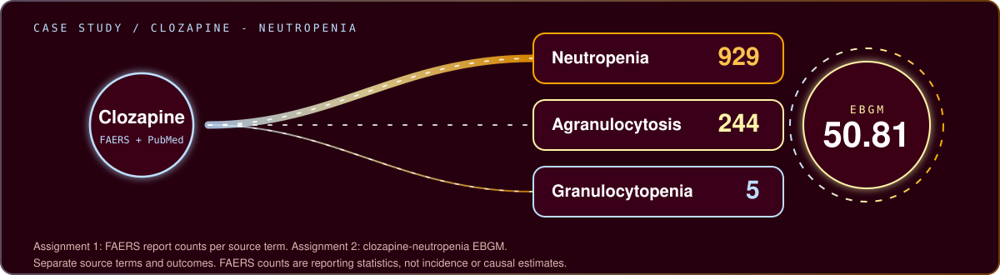

<div align="center">



<br/>

[](https://pharmaintel.streamlit.app/)


<br/>

[**Case study**](#case-study) &nbsp;·&nbsp;
[**Components**](#project-components) &nbsp;·&nbsp;
[**Development sequence**](#development-sequence) &nbsp;·&nbsp;
[**Environment**](#development-environment) &nbsp;·&nbsp;
[**PubMed sample**](#retrieve-the-initial-pubmed-sample) &nbsp;·&nbsp;
[**Evidence and graph**](#relation-evidence-signal-ranking-and-knowledge-graph) &nbsp;·&nbsp;
[**Dashboard**](#transformer-corpus-run-and-dashboard) &nbsp;·&nbsp;
[**Notebook and hosting**](#notebook-and-hosting) &nbsp;·&nbsp;
[**Status**](#current-implementation-status) &nbsp;·&nbsp;
[**Layout**](#repository-layout)

</div>


# PharmaIntel-AI

**AI-powered pharmacovigilance intelligence from biomedical literature.**

> PharmaIntel-AI is a research and portfolio project for retrieving PubMed literature, extracting drug and adverse-event mentions, analysing their sentence-level relationships, and prioritizing traceable evidence for review. It is a literature-mining aid; it does not establish clinical causality or replace pharmacovigilance review.

| Retrieve | Extract | Relate | Prioritize | Explore |
|:---:|:---:|:---:|:---:|:---:|
| PubMed literature | Drug and adverse-event mentions | Sentence-level relationships | Traceable evidence for review | Streamlit dashboard and GraphML graph |


## Case study

<div align="center">

</div>

<br/>

The initial case study is **clozapine–neutropenia**, selected because it is present in both supplied FAERS assignments.

| Source term | Origin | Value |
|---|---|---:|
| Neutropenia | Assignment 1, reports | **929** |
| Agranulocytosis (separate row) | Assignment 1, reports | 244 |
| Granulocytopenia (separate row) | Assignment 1, reports | 5 |
| Clozapine–neutropenia | Assignment 2, EBGM | **50.81** |

**Terminology.** These are separate source terms and outcomes. Any grouping into a broader hematological event family will be documented as a terminology mapping, not treated as equivalence.

FAERS counts are reporting statistics, not incidence or causal estimates.


## Project components

| Component | Planned work |
|---|---|
| Data acquisition | Implemented: PubMed retrieval with PMID-level provenance and reproducible search metadata |
| Biomedical NLP | NER benchmark completed; BC5CDR BiomedBERT selected as the transformer baseline |
| Drug NER | Transformer-based extraction plus an interpretable rule-based baseline |
| ADR NER | Transformer-based adverse-event extraction plus baseline comparison |
| Relation extraction | Implemented: pair-scoped rule baseline separating relation language from co-mention |
| Context analysis | Implemented: lexical negation/speculation cues with traceable spans; scope remains unvalidated |
| Evaluation | Manually annotated sample, precision/recall/F1, and error analysis |
| Signal prioritization | Literature triage score plus an explicitly uncalibrated cross-source profile for clozapine–neutropenia (FAERS EBGM + literature evidence) |
| Knowledge graph | Implemented: GraphML evidence graph connecting drugs, ADRs, sentences, and PMIDs |
| Dashboard | Implemented: modular Streamlit pages for overview, signals, evidence, graph, SocialPulse, and methods |
| SocialPulse | FDA Drug Safety Communications archive filtered for clozapine/Clozaril; six-hour cache and optional local sample screen; no paid X API |
| Deliverables | Notebook, ranked CSV, 2–3 page PDF report, and GitHub repository |

### Command quick reference

| Purpose | Command |
|---|---|
| Retrieve the PubMed sample | `python -m pharmaintel.data_acquisition.pubmed --max-results 100` |
| Create review and annotation CSVs | `python scripts/prepare_ner_annotation.py` |
| Annotate NER sentences | `streamlit run dashboard/annotation_app.py` |
| Run the NER benchmark | `python scripts/run_ner_benchmark.py` |
| Audit the cross-source index | `python scripts/audit_cross_source_index.py` |
| Build evidence, ranking and graph | `python scripts/run_corpus_intelligence.py` |
| Run the transformer over the corpus | `python scripts/run_transformer_corpus_ner.py` |
| Launch the dashboard | `streamlit run dashboard/app.py` |
| Prepare the relation holdout | `python scripts/prepare_relation_holdout.py` |
| Annotate relation pairs | `streamlit run dashboard/relation_annotation_app.py` |
| Evaluate the relation holdout | `python scripts/evaluate_relation_holdout.py` |
| Build research figures | `python scripts/build_research_figures.py` |
| Prepare hosted dashboard assets | `python scripts/prepare_dashboard_assets.py` |


## Development sequence

<div align="center">

</div>

<br/>

1. Architecture and environment
2. PubMed retrieval and provenance
3. Model inventory and benchmarking (architecture, input format, output labels, licensing, compute needs)
4. Drug and ADR entity extraction, comparing transformer outputs to rule-based baselines
5. Drug–ADR relationship extraction and context analysis
6. Manual annotation, quantitative evaluation, and error analysis
7. Evidence-level traceability and transparent signal ranking
8. Knowledge graph
9. Streamlit + Plotly dashboard
10. Final notebook, CSV, report, documentation, and repository publication

### Method boundaries

| Topic | What to know |
|---|---|
| Rule matching | Keyword/rule matching is treated as a baseline, not a complete NLP system. |
| Transformer role | The selected transformer is used for entity candidates, while relation and assertion decisions currently use a transparent lexical baseline. |
| Model confidence | Model confidence is not a causal probability. |

### SocialPulse scope

- Shows official FDA Drug Safety Communications that mention clozapine/Clozaril, separately from PubMed and FAERS.
- Parses the current FDA archive listing; entries older than the page’s archive boundary may require following FDA’s historical archive link.
- Does not include general news or X posts; official X API reads are pay-per-use.
- Optional user-supplied social samples require permitted access, de-identification, and human validation before research claims.


## Development environment

The project targets Python 3.10–3.12.

### Step 1. Create the environment

Create an isolated environment and install the project dependencies:

```bash
python3 -m venv .venv
source .venv/bin/activate
python -m pip install --upgrade pip
python -m pip install -e ".[all]"
```

### Step 2. Install PyTorch

Install PyTorch separately so CPU-only machines do not accidentally download CUDA libraries. For the current Ubuntu CPU setup:

```bash
python -m pip install torch --index-url https://download.pytorch.org/whl/cpu
```

For another platform or an NVIDIA GPU, use the appropriate command from the [official PyTorch installation selector](https://pytorch.org/get-started/locally/). The `requirements.txt` file installs the project extras; install the matching PyTorch build as a separate platform-specific step.

Model weights are downloaded from Hugging Face when a selected model is first used and are not stored in the repository.

### Reference machine

| OS | Python | CPU | RAM | GPU |
|---|---|---|---|---|
| Ubuntu 22.04 | 3.10 | Intel Core i7-13700 | 16 GB | None (no NVIDIA GPU) |

CPU inference is the initial target; latency and memory use must be measured before selecting models.


## Retrieve the initial PubMed sample

### 1. Run the retrieval

Set a contact email for NCBI and run the default clozapine–neutropenia search:

```bash
export NCBI_EMAIL="your-email@example.org"
python -m pharmaintel.data_acquisition.pubmed --max-results 100
```

| Output | Location |
|---|---|
| Normalized source records and retrieval metadata | `data/raw/pubmed/` |
| Records CSV and sentence-level CSV | `data/processed/pubmed/` |

PMID, title, publication details, query, and retrieval time are retained so each sentence can be traced to its source. Raw and processed data directories are git-ignored. The query and result limit can be changed with `--query` and `--max-results`; PubMed's relevance ordering is the default.

<details>
<summary><b>Services, credentials and local inference</b></summary>

<br/>

- This acquisition step calls **NCBI PubMed E-utilities** through Biopython.
- Set `NCBI_EMAIL` to identify the client; `NCBI_API_KEY` is optional.
- The transformer runs locally with PyTorch after downloading the public, revision-pinned Hugging Face checkpoint.
- PharmaIntel does not use the OpenAI API or any hosted LLM inference API.

</details>

The sentence splitter is a deterministic rule baseline with common abbreviation guards. It is intended to prepare reviewable sentences for later biomedical NLP, not as a validated sentence-boundary model.

### 2. Review the corpus and prepare annotation

The current dated retrieval snapshot and relevance caveats are in [the corpus review](docs/corpus_review.md). To create the review and annotation CSVs, run:

```bash
python scripts/prepare_ner_annotation.py
```

### 3. Annotate

Use the local annotation screen to label the sample sentence by sentence:

```bash
streamlit run dashboard/annotation_app.py
```

- The screen lets you inspect and correct spans in `gold_entities_json` in `data/annotated/ner_annotation_sample.csv`.
- Candidate model predictions stay hidden.
- Read [the NER annotation guide](docs/ner_annotation_guide.md) before starting.
- The random and target-enriched strata must remain separate.

### 4. Benchmark

After every row has a reviewed JSON annotation and `review_status` is `complete`, run the benchmark:

```bash
python scripts/run_ner_benchmark.py
```

This runs the target-term lexical baseline and the two shortlisted Hugging Face token-classification models, then writes strict exact-span metrics separately for each sampling stratum.

- The target-term baseline is intentionally narrow.
- The models' Chemical/Disease or broad biomedical labels are mapped to the project's DRUG/ADR targets only for comparison; original labels and model revisions are retained in provenance.
- Model outputs and confidence scores are not causal evidence.

The first completed benchmark and model-selection rationale are in [NER benchmark results](docs/ner_benchmark_results.md).

### 5. Audit the cross-source index

The exploratory clozapine–neutropenia cross-source index has an automated
arithmetic and weight-sensitivity audit:

```bash
python scripts/audit_cross_source_index.py
```

The current result reproduces 89.04 (shown as 89.0) and checks paper-status
count reconciliation.

This does not validate predictive or clinical meaning: only one pair has assignment-provided FAERS inputs, the relation holdout is pending, and component weights were not learned from independent outcomes. See the audit results and limitations in [signal prioritization](docs/signal_prioritization.md).


## Relation evidence, signal ranking, and knowledge graph

After PubMed retrieval, generate traceable case-study evidence, ranked signal
counts, and a GraphML knowledge graph:

```bash
python scripts/run_corpus_intelligence.py
```

The script scans the local sentence CSV and produces:

| Output | Location |
|---|---|
| Ranked aggregate | `results/ranked_signals.csv` |
| Evidence graph | `results/pharmaintel_evidence_graph.graphml` |
| PMID-level sentence evidence (retained locally) | `data/processed/pubmed/` |

The score prioritizes literature-review candidates; it is not a probability or causal estimate. Read the [scoring method and limitations](docs/signal_prioritization.md) before interpreting ranks.


## Transformer corpus run and dashboard

### Transformer NER over the corpus

The selected BC5CDR token classifier is pinned to a model revision and can run
offline after its Hugging Face snapshot has been cached. It scans the local
sentence corpus and writes NER predictions, pair-level evidence, a case-study
ranking, GraphML, and a provenance/limitations summary:

```bash
python scripts/run_transformer_corpus_ner.py
streamlit run dashboard/app.py
```

| Topic | Behaviour |
|---|---|
| Model labels | BC5CDR outputs `Chemical` and `Disease`, not drug-specific and ADR-specific classes. |
| App handling | The app retains those labels and scores and restricts the primary case-study ranking to clozapine and a declared blood-event term list. |
| Metrics | Corpus metrics are not reported without independent gold annotations. |

### Blinded relation holdout

A PMID-disjoint blinded relation sample and local annotation screen are also
available:

```bash
python scripts/prepare_relation_holdout.py
streamlit run dashboard/relation_annotation_app.py
```

- The sample has one candidate pair per PMID, excludes the development PMIDs, and contains no model predictions.
- After every row is reviewed and saved, the gated evaluator can be run with `python scripts/evaluate_relation_holdout.py`.

The resulting metrics are only independent-human validation if the annotations were completed by a reviewer who did not create the development labels/rules; the evaluator records this limitation explicitly.


## Notebook and hosting

<div align="center">

[](https://pharmaintel.streamlit.app/)

</div>

**Live dashboard:** [PharmaIntel Safety Intelligence](https://pharmaintel.streamlit.app/)

### Notebook and figures

- The self-contained, rendered seven-part assignment workflow and caveats are in [`notebooks/01_pharmaintel_pipeline.ipynb`](notebooks/01_pharmaintel_pipeline.ipynb).
- Saved palette-matched PNG figures are created with `python scripts/build_research_figures.py`.

### Run the hosted results explorer locally

For the hosted results explorer, first regenerate the compressed static outputs and run the app locally:

```bash
python scripts/prepare_dashboard_assets.py
streamlit run dashboard/app.py
```

### Deployment

The same app is deployed from the public GitHub repository to Streamlit Community Cloud with entrypoint `dashboard/app.py`.

| Feature | Behaviour |
|---|---|
| Precomputed model outputs | Displayed alongside the live features below |
| Live PubMed literature carousel | Refreshed through NCBI E-utilities and shared-cached for six hours |
| SocialPulse | Reads the free public FDA Drug Safety Communications archive and caches it for six hours; no runtime API credentials are needed |

These are source-linked notices, not an automated assessment of causality. See [hosting and API details](docs/deployment.md).

### App structure

- The app uses Streamlit's page navigation with page modules under `dashboard/pages/` and shared loading/styles in `dashboard/shared.py`.
- Signal terms display a within-corpus relative literature index; only the exact clozapine–neutropenia pair has the supplied FAERS values for the separate, exploratory cross-source profile.


## Current implementation status

| Area | Status |
|---|---|
| PubMed retrieval | Implemented |
| Initial NER benchmark | Implemented |
| Pair-scoped relation/assertion rules | Implemented |
| Unique-PMID evidence scoring | Implemented |
| Provenance-preserving GraphML | Implemented |
| Dashboard | Includes an evidence explorer, interactive graph, audited exploratory cross-source profile, and SocialPulse news feed plus optional screening sandbox |
| Composite arithmetic and weight sensitivity | Reproducible, but the index is not calibrated or clinically validated |
| Pinned BC5CDR model | Run across the 3,915-sentence local snapshot |
| Relation holdout | A 60-record PMID-disjoint sample is prepared, but blinded human review remains pending, so no held-out relation metrics are available |

See the [relation methods](docs/relation_extraction_baseline.md), [annotation guide](docs/relation_annotation_guide.md), and [signal prioritization method](docs/signal_prioritization.md).


## Repository layout

```text
.
├── data/{raw,processed,annotated}/   # local data; files are git-ignored
├── dashboard/                        # Streamlit application
├── docs/                              # research plan and methods notes
├── notebooks/                         # assignment and exploratory notebooks
├── results/{figures,evaluation}/      # generated outputs; data files are ignored
├── src/pharmaintel/                  # installable pipeline package
└── tests/                             # automated checks
```

<div align="center">

<br/>


[Back to top](#pharmaintel-ai)

</div>
